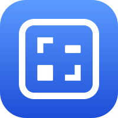

A design tool for screens, built for people and agents. Describe a screen in a sentence and it draws, then edit it like you would in Figma or Photoshop: real buttons, fields and switches on artboards, a brush, selections, gradients, color and adjustment layers.

Under the real look every screen is still text on a character grid. One switch in Settings shows it as characters, and it pastes into a commit, an issue, a README or a chat and stays editable. The same project opens on the web, iPhone, iPad, Mac, Apple Watch and the terminal.

Formerly Glyphbox. Same app, same files, new name.

**Live:** [icelus.jaybulb.com](https://icelus.jaybulb.com). Free on the web, $0.99 on the App Store.

## Features

- A real canvas (v36): parts draw as real controls on artboards, the way a design tool shows them. Arrows, paint and charts keep their character style, and the text look is a switch in Settings (`src/lib/real.js`)
- Describe it (v37, web): a chat panel. Say what a screen is for and it appears on the canvas; pick a screen and say what to change and it redraws that screen. Workers AI behind `POST /api/describe`, app origin only
- An optional account (email and password) with Profile and Settings; everything works without one
- Simple to start: a five-step tutorial, the basics up front, everything else one tap away under More
- 38 parts, from Button and Input to Table, Date picker and Tab bar, plus Arrow, Text, Banner and Boxy
- Part packs in the style of iOS, Material, the terminal and email, and your own parts saved to the palette
- Screens side by side, linked by arrows, from templates, copied as one document with the flow
- Type a screen in a few lines, paste any text wireframe, or capture a live web page, and edit it
- Tables, bar charts, sparklines, flowcharts, sequence diagrams and trees, drawn from what you type
- Hand it to Claude Code: one build brief with every screen, part, flow, state and note
- Code export: a React component with plain CSS or a SwiftUI view that compiles
- Decks: present your screens one by one, or save them as a PDF or one HTML file
- Brush and eraser: paint any character freehand, one to five cells wide
- Selections: a marquee or a magic wand picks cells to copy, cut, fill or move
- Gradients: drag a ░ ▒ ▓ █ ramp, straight or round
- Color: ink and paper from the 16 terminal colors, copied as ANSI or kept in HTML and images
- Adjustment layers: invert, dim, ASCII only or a box style for everything under an area, without touching it
- Masks: crop a part, or clip it to the shape of another, without cutting a single character
- Agent kit: MCP resources (syntax, parts, worked examples) and prompts to sketch, review and build ([docs/EXAMPLES.md](docs/EXAMPLES.md))
- Three takes on any screen side by side (stacked, split, dense), then keep the one you like
- Tweak a screen with live knobs: spacing, padding and one box style for every box
- Pin a note to any part for a teammate or an agent, who reads it over MCP and resolves it
- `icelus system <repo>` turns your components into parts and your radius tokens into a box style
- Review a screen: overlaps, boxes cut open, placeholder labels, missing empty and error states (app, CLI, API)
- Groups, layers you can hide and lock, symbols that stay linked, and pressed, disabled and error states
- Turn a photo into blocks, braille or soft shade, trace over one, or fill an area with a shade
- Copy as text, Markdown, plain ASCII, typed lines or HTML, share a link, embed it, or save an image
- Highlights, five box styles, snap guides, zoom, and undo 50 steps back
- Every key works and VoiceOver reads it; 27 languages
- Web, iPhone, iPad, Mac, Apple Watch and the terminal, all on one project file
- An API, an MCP server, Shortcuts actions and a GitHub Action, so agents and builds can draw too

## Run

```bash
npm install && npm run dev
npm test
```

Command line: `printf '"Email"  [Sign in]' | node bin/icelus.js draw` (also `text`, `lines`, `project`, `lint`). Terminal app: `swift build`, then `icelus-tui place sketch.json button 4 2` or `icelus-tui render sketch.json`. API and agent tools: [docs/API.md](docs/API.md). Describe it needs the Workers AI binding (`[ai]` in `wrangler.toml`), so it works on the deployed site and not under `npm run dev`.

## Check wireframes in CI

Icelus is also a GitHub Action. It fails the build when a box in a Markdown wireframe no longer closes:

```yaml
- uses: nulljosh/icelus@v37.0.0
  with: { files: "README.md docs/*.md" }
```

## More

[Whitepaper](WHITEPAPER.md) · [Architecture](docs/ARCHITECTURE.md) · [API](docs/API.md) · [Examples](docs/EXAMPLES.md) · [Strategy](docs/STRATEGY.md) · [Roadmap](roadmap.md) · [Brand](brand/BRAND.md) · [Privacy](PRIVACY.md)

## License

Apache License 2.0, 2026 Joshua Trommel.
